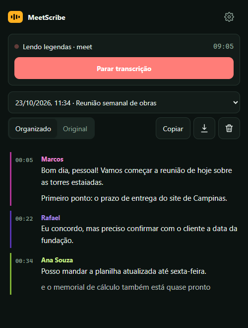
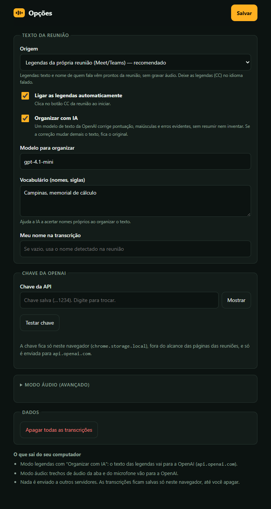

# MeetScribe

Extensão do Chrome que transcreve reuniões do **Google Meet** e do **Microsoft Teams (web)** a partir das **legendas da própria reunião**, com o nome de quem está falando. Opcionalmente, um modelo de texto da OpenAI organiza o resultado (pontuação, maiúsculas, erros evidentes) sem resumir nem inventar.

> Projeto independente. Não é afiliado nem endossado por Google, Microsoft ou OpenAI.

## Telas

  
  &nbsp;&nbsp;
  

Painel lateral (esquerda) e página de opções (direita). Os nomes e falas das imagens são fictícios, apenas ilustrativos.

## Como funciona

1. Um script de leitura (somente leitura) observa a região de legendas da reunião e envia cada fala com o nome do falante.
2. O service worker junta as atualizações de cada fala (as legendas crescem, são revisadas e rolam) em uma linha por turno.
3. Se **Organizar com IA** estiver ligado, as linhas finalizadas vão para a API da OpenAI para correção. A versão corrigida só é aceita se mantiver as mesmas palavras, na mesma ordem, e os mesmos números e negações; caso contrário fica o texto original.
4. O painel lateral mostra a transcrição ao vivo, com alternância **Organizado / Original**, cópia e exportação em `.txt` e `.md`.

Há também um **modo áudio** (avançado): captura o áudio da aba e do microfone e transcreve com `gpt-4o-transcribe` (opcionalmente com diarização).

## Instalação (modo desenvolvedor)

1. Clone ou baixe este repositório.
2. Abra `chrome://extensions` e ative **Modo do desenvolvedor**.
3. **Carregar sem compactação** e escolha a pasta do repositório.
4. Em **Opções**, cole sua chave da OpenAI (só é necessária para "Organizar com IA" e para o modo áudio) e clique em **Testar chave**.

Requer Chrome 116 ou superior. Não há etapa de build nem dependências.

## Uso

1. Entre na reunião e deixe o idioma das legendas igual ao idioma falado.
2. Clique no ícone do MeetScribe e em **Iniciar transcrição**. A extensão liga as legendas (CC) sozinha, se você deixou essa opção ativa.
3. Ao terminar, clique em **Parar transcrição**. O texto fica salvo no navegador até você apagar.

## Privacidade e segurança

- **Sem servidor próprio, sem telemetria.** A única rede usada é `https://api.openai.com`.
- **O que sai do computador:** com "Organizar com IA", o texto das legendas (com os nomes dos falantes e um pouco de contexto) vai para a OpenAI; no modo áudio, trechos de áudio vão para a OpenAI. Veja a política de retenção de dados da API da OpenAI.
- **Chave da API:** fica em `chrome.storage.local`, em texto simples no perfil do Chrome, inacessível às páginas das reuniões (`TRUSTED_CONTEXTS`). Qualquer programa rodando como o seu usuário pode ler esse arquivo. Use uma chave de projeto com limite de gasto.
- **Transcrições:** ficam só no navegador; há "Apagar sessão" e "Apagar todas as transcrições". A URL salva não inclui parâmetros de consulta.
- **Os scripts nas páginas só leem a tela** e ficam inativos até você iniciar a transcrição naquela aba.
- **Nomes de falantes não são autenticados:** vêm da reunião e podem ser escolhidos pelos participantes. Não trate a transcrição como prova.
- **Consentimento:** gravar ou transcrever reuniões pode exigir aviso e consentimento dos participantes (LGPD, GDPR, leis locais). A responsabilidade é de quem usa.

Para reportar uma vulnerabilidade, abra uma *security advisory* privada no GitHub.

## Limitações

- Os formatos de tela do Meet e do Teams mudam sem aviso. O Meet é o mais testado; o Teams é menos garantido.
- A qualidade do texto depende das legendas da plataforma. A IA só corrige o que o contexto torna evidente.

## Estrutura

| Arquivo | Função |
|---|---|
| `manifest.json` | Manifest V3, permissões mínimas e CSP restrita |
| `background.js` | Service worker: sessões, início/parada, validação de mensagens |
| `captions.js` | Junta legendas em falas e organiza com a OpenAI |
| `content/meet.js`, `content/teams.js` | Leitura das legendas (somente leitura) |
| `offscreen.js`, `worklet.js` | Modo áudio: captura, corte por pausa, transcrição |
| `sidepanel.*`, `options.*`, `ui.css` | Interface |

## Licença

MIT. Veja `LICENSE`.
